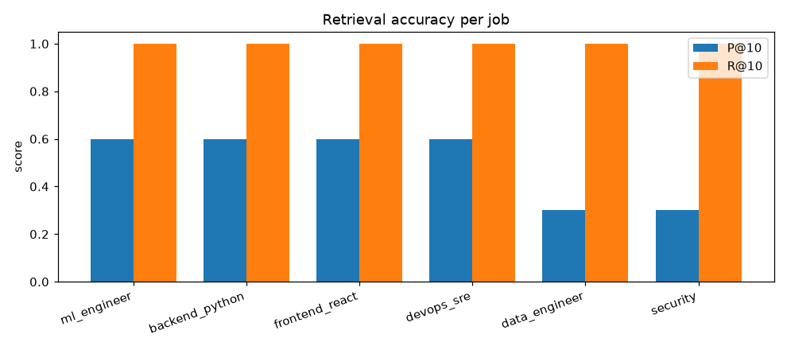

# Resume RAG + Job Matcher

A retrieval-augmented resume search and job-matching engine. Resumes are
chunked by section, embedded, and stored in a vector database; a job
description is embedded and matched against them with **hybrid search**
(semantic + critical-skill keyword overlap), 0–100 scoring, must-have
filtering, and explainable reasoning.

Fully **local and free** — HuggingFace `all-MiniLM-L6-v2` embeddings + ChromaDB.
No API keys, no network after the first model download.



## Architecture

```
resumes/ ──► fs_tools.read_file ──► section-aware chunking ──► MiniLM embed ──► ChromaDB
 (TXT/DOCX/PDF)   (Milestone 1)      (Summary/Skills/Exp/Edu)    (384-dim)      (+ metadata)
                                                                                    │
job description ──► MiniLM embed ──► top-K semantic retrieve ──► aggregate ◄────────┘
                                         │
                                         ▼
          hybrid re-score (semantic + keyword) ──► must-have / min-years filter ──► ranked JSON
```

| File | Role |
|---|---|
| `fs_tools.py` | File loading (PDF/TXT/DOCX) — reused from Milestone 1. |
| `generate_dataset.py` | Creates 36 resumes (mixed formats) + 6 JDs + `dataset_meta.json`. |
| `resume_rag.py` | Part A — load, chunk, extract metadata, embed, store in ChromaDB. |
| `job_matcher.py` | Part B — hybrid search, scoring, filtering, JSON output. |
| `notebook.ipynb` | Experimentation + metrics (accuracy, latency, hybrid vs. semantic). |
| `demo.sh` | Paced end-to-end walkthrough. |

## Setup

```bash
python3.12 -m venv .venv && source .venv/bin/activate
pip install -r requirements.txt

python generate_dataset.py     # writes resumes/, jobs/, dataset_meta.json
python resume_rag.py build     # builds the ChromaDB index at ./chroma_db
```

## Usage

```bash
# Match a JD file, enforcing must-have skills and minimum experience
python job_matcher.py jobs/jd_ml_engineer.txt \
    --must-have "Python,Machine Learning" --min-years 5 --top-k 10

# Or pass JD text directly
python job_matcher.py "Senior Python engineer, 5+ years, ML and NLP" --top-k 10
```

### Output format

```json
{
  "job_description": "...",
  "requirements": { "must_have": ["Python", "Machine Learning"], "min_years": 5 },
  "top_matches": [
    {
      "candidate_name": "Aisha Khan",
      "resume_path": "resumes/Aisha_Khan.txt",
      "match_score": 87,
      "experience_years": 9,
      "matched_skills": ["Machine Learning", "NLP", "Python", "PyTorch", "TensorFlow"],
      "missing_must_have": [],
      "meets_requirements": true,
      "relevant_excerpts": ["..."],
      "reasoning": "Matches 6 required/related skill(s)... 9 years (meets 5+ requirement)..."
    }
  ]
}
```

## How it works

- **Section-aware chunking** — resumes are split on headings (Summary, Skills,
  Experience, Education) so each chunk is a coherent section; retrieved
  excerpts and "which section matched" stay meaningful.
- **Metadata extraction** — candidate name, skills (matched against a known-skill
  vocabulary), years of experience (explicit "N years" or inferred from dates),
  and education are stored alongside each chunk for filtering.
- **Hybrid scoring** — `score = 100 × (0.6 · semantic_similarity + 0.4 ·
  critical_skill_overlap)`. Semantic finds relevant candidates; keyword overlap
  on JD skills sharpens ranking.
- **Must-have filtering** — candidates missing a required skill or below the
  minimum years are marked `meets_requirements: false` and ranked below
  qualified ones (kept visible as near-misses rather than dropped).

## Metrics (from `notebook.ipynb`)

Ground truth: a resume is relevant to a JD if its role is in the JD's target
roles (3–6 relevant per JD, so P@10 is upper-bounded by `relevant/10`).

| Metric | Result |
|---|---|
| Recall@10 | **1.00** (all relevant candidates retrieved) |
| Hit@1 | **1.00** (top result always role-relevant) |
| MRR | **1.00** |
| P@10 | 0.50 mean (at the ceiling given small relevant sets) |
| JD embed latency | ~tens of ms |
| Full query latency | sub-second (vector query a few ms) |

Run it yourself: `jupyter notebook notebook.ipynb` (already executed with
outputs committed).

## Demo

`./demo.sh` runs the full pipeline (build → match ML JD → match DevOps JD) with
section banners — screen-record it for the walkthrough. See `demo/` for a
pre-rendered cast/GIF/MP4.

## Notes

- First run downloads the MiniLM model (~90 MB) to the HF cache; subsequent runs
  are offline.
- `chroma_db/` is regenerable (`resume_rag.py build`) and gitignored.
- Dataset is synthetic (no PII) and reproducible via `generate_dataset.py`.
